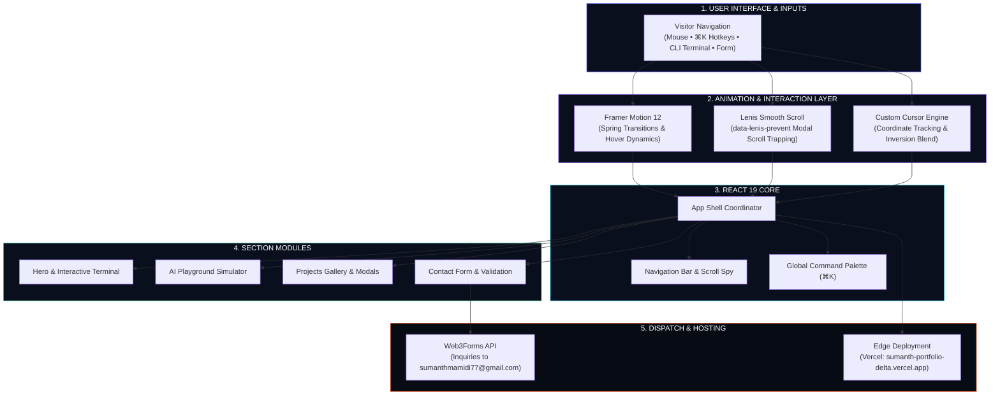

<div align="center">

# ✦ Sumanth's Portfolio
### *AI/ML Engineer & Full-Stack Developer*

**An interactive portfolio bridging intelligent AI systems with modern full-stack web engineering.**

[](https://react.dev/)
[](https://vitejs.dev/)
[](https://tailwindcss.com/)
[](https://www.framer.com/motion/)
[](https://developer.mozilla.org/en-US/docs/Web/JavaScript)
[](https://lenis.darkroom.engineering/)
[](https://web3forms.com/)
[](./LICENSE)

[](https://sumanth-portfolio-delta.vercel.app/)

[Overview](#overview) • [Portfolio Sections](#sections) • [Interactive Features](#features) • [Architecture](#architecture) • [Project Structure](#structure) • [Quickstart](#quickstart) • [Tech Stack](#tech-stack) • [Author & Contact](#author)

</div>

---

<a id="overview"></a>
## 📖 Overview

This repository houses the complete source code for **Sumanth's Portfolio** — an executive, high-performance personal platform engineered to demonstrate advanced machine learning pipelines, production full-stack architectures, and interactive digital experiences.

Built with **React 19**, **Vite 8**, and **Tailwind CSS v4**, the platform bridges technical depth with modern creative engineering through hardware-accelerated animations, live CLI terminal access, and an obsidian design system.

---

<a id="sections"></a>
## 🗂️ Portfolio Sections

> **⚡ Hero & Terminal**  
> Dynamic headline, profile stats counter, interactive background intro audio player, and a fully functional embedded CLI terminal emulator.
>
> **🧠 About & Expertise**  
> Comprehensive overview of technical background, core focus areas (AI/ML, Systems Engineering, Modern Web), and problem-solving philosophy.
>
> **🤖 Interactive AI Playground**  
> Real-time visualizers demonstrating multi-agent decision loops, RAG pipeline vector chunking, and inference latency telemetry.
>
> **💼 Featured Projects Gallery**  
> Filterable project showcase (*AI & ML*, *Interactive*, *Systems*) with rich preview modals, architecture tags, and repository links.
>
> **📜 Verified Certifications**  
> Interactive credential cards highlighting certified specializations in Machine Learning, Deep Learning, and Software Development.
>
> **📬 Contact Studio**  
> Client-side validated inquiry form integrated with Web3Forms for direct-to-inbox messaging with zero backend dependencies.

---

<a id="features"></a>
## 🎮 Interactive Features

| Feature | Interaction | Purpose |
| :--- | :--- | :--- |
| **Command Palette** | `⌘K` or `Ctrl+K` | Quick-search across sections, projects, and external links |
| **CLI Terminal** | Type commands (`help`, `skills`, `projects`) | Explore background and competencies in a developer-native environment |
| **Audio Intro Player** | Tap the sound pill button | Toggle procedural ambient intro narration with live equalizer animation |
| **Project Modals** | Click any project card | Open detailed view with feature lists, tech stack, and trapped scroll container |
| **Smooth Momentum** | Mouse wheel or touch scroll | Hardware-accelerated Lenis scrolling with isolated modal containers |
| **Dynamic Cursor** | Move pointer over elements | `mix-blend-difference` custom cursor providing high-contrast inverted feedback |

---

<a id="architecture"></a>
## 🏗️ Architecture

The diagram below outlines the portfolio's component hierarchy, state flow, and external service communication:



---

<a id="structure"></a>
## 📁 Project Structure

```
WebPortfolio/
├── public/
│   ├── assets/                 # Profile avatars, certificates, video assets
│   └── data/
│       ├── certificates.json   # Certifications dataset
│       ├── profile.json        # Bio, coordinates, and social profiles
│       ├── projects.json       # Projects catalog & tags
│       └── skills.json         # Technical skill categories
├── src/
│   ├── components/
│   │   ├── effects/            # CustomCursor, GradientMesh, ambient effects
│   │   ├── layout/             # SmoothScroll, Navbar, Footer
│   │   ├── ui/                 # SpotlightCard, TiltCard, SectionHeader
│   │   ├── AIPlayground.jsx    # Interactive AI pipeline simulator
│   │   ├── About.jsx           # Background and philosophy
│   │   ├── Certifications.jsx  # Verified certification cards
│   │   ├── Contact.jsx         # Direct contact form with Web3Forms
│   │   ├── Expertise.jsx       # Competency overview
│   │   ├── Hero.jsx            # Hero banner, terminal & audio player
│   │   ├── Preloader.jsx       # Initial loading screen
│   │   ├── Projects.jsx        # Project gallery & modal system
│   │   └── Skills.jsx          # Interactive skills cloud
│   ├── hooks/                  # Custom data hooks (useProfile, useProjects)
│   ├── App.jsx                 # Application layout coordinator
│   ├── main.jsx                # React root mount
│   └── index.css               # Design tokens, variables & resets
├── .env.example                # Environment variables template
├── LICENSE                     # MIT License
├── package.json                # Project dependencies and scripts
├── SETUP_CONTACT_FORM.md       # Contact form configuration guide
└── vite.config.js              # Vite configuration (base: './')
```

---

<a id="quickstart"></a>
## ⚡ Quickstart

### Local Setup

```bash
# 1. Clone the repository
git clone https://github.com/SumanthMamidi-MNS/WebPortfolio.git
cd WebPortfolio

# 2. Install dependencies
npm install

# 3. Start local development server
npm run dev
```

Open **[http://localhost:5173](http://localhost:5173)** in your browser.

---

### Production Build

```bash
# Build optimized static bundle
npm run build

# Preview build locally
npm run preview
```

---

### Deployment

- **Vercel (Production)**: Live at **[sumanth-portfolio-delta.vercel.app](https://sumanth-portfolio-delta.vercel.app/)** — automatic continuous deployment connected to Git.
- **Custom Domain / Netlify**: Build command `npm run build` with publish directory `dist`.

---

<a id="tech-stack"></a>
## 🛠️ Tech Stack

| Component | Technology | Role |
| :--- | :--- | :--- |
| **Framework** | [React 19](https://react.dev/) | Component architecture, state management & concurrency |
| **Bundler** | [Vite 8](https://vitejs.dev/) | Instant HMR development and fast Rollup builds |
| **Styling** | [Tailwind CSS v4](https://tailwindcss.com/) | Modern utility engine and custom design token system |
| **Animations** | [Framer Motion 12](https://www.framer.com/motion/) | Spring-based layout animations, enters & modal transitions |
| **Smooth Scroll** | [Lenis](https://lenis.darkroom.engineering/) | Smooth scroll momentum with modal containment |
| **Icons** | [Lucide React](https://lucide.dev/) | Minimalist developer iconography |
| **Contact Form** | [Web3Forms API](https://web3forms.com/) | Serverless contact forwarding straight to Gmail |
| **Typography** | [Bricolage Grotesque](https://fonts.google.com/specimen/Bricolage+Grotesque) | Modern display and interface typography |

---

<a id="author"></a>
## 👤 Author & Contact

**Sumanth Mamidi**  
*AI/ML Engineer & Developer — Chennai, India (Remote Worldwide)*

- 📧 **Email**: [sumanthmamidi77@gmail.com](mailto:sumanthmamidi77@gmail.com)
- 🐙 **GitHub**: [@SumanthMamidi-MNS](https://github.com/SumanthMamidi-MNS)
- 💼 **LinkedIn**: [mns-sumanth](https://www.linkedin.com/in/mns-sumanth)
- 📸 **Instagram**: [@_m_n_s_sumanth_](https://www.instagram.com/_m_n_s_sumanth_)

---

## 📄 License

Distributed under the **MIT License**. See [`LICENSE`](./LICENSE) for details.

---

<div align="center">

Designed & Developed by **[Sumanth Mamidi](https://github.com/SumanthMamidi-MNS)**

<sub>Copyright © 2026 Sumanth Mamidi. All rights reserved.</sub>

</div>
