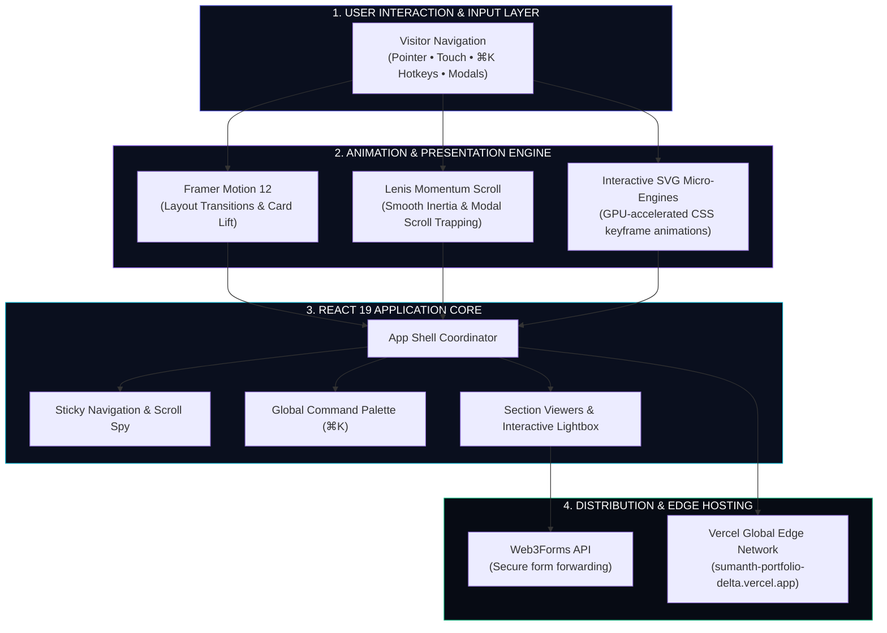

<div align="center">

# ✦ Sumanth's Portfolio
### *AI/ML Engineer & Systems Developer*

**An executive personal engineering platform bridging intelligent AI systems, deep learning architectures, and modern full-stack web technologies.**

[](https://sumanth-portfolio-delta.vercel.app/)

[](https://react.dev/)
[](https://vitejs.dev/)
[](https://tailwindcss.com/)
[](https://www.framer.com/motion/)
[](https://lenis.darkroom.engineering/)
[](./LICENSE)

[Overview](#overview) • [Featured Work](#featured-work) • [Interactive Architecture](#architecture) • [Project Structure](#structure) • [Running Locally](#running-locally) • [Tech Stack](#tech-stack) • [Author & Contact](#author)

</div>

---

<a id="overview"></a>
## 📖 Overview

This repository contains the complete production source code for **Sumanth's Portfolio** — a high-performance personal platform engineered to demonstrate advanced machine learning pipelines, multi-agent systems, and production full-stack architectures.

### Key Highlights
- **Published Research**: First author on the *SECUREPATCH* multi-agent LLM automated security repair architecture (*AVE Trends in Intelligent Computing Systems*, 2026, DOI: `10.64091/ATICS.2026.000283`).
- **Real-World Systems**: 6 production-grade systems spanning oceanographic vision transformers, traffic intelligence ANPR tracking, citation-verified legal RAG, and micro-climate forecasting.
- **Craft & Performance**: Dark-mode-first aesthetic with bespoke SVG micro-animations, hardware-accelerated momentum scrolling (Lenis), Spring physics transitions (Framer Motion), and zero cumulative layout shift (CLS).

---

<a id="featured-work"></a>
## 💼 Featured Engineering & Research

### Flagship Projects
| Project | Domain | Architecture & Metric |
| :--- | :--- | :--- |
| **OceanEmbed** | AI & Oceanography | **CNN-Vision Transformer** reconstructing 3D ocean temperature down to 1,000 m (accurate within ~1 °C of physical ARGO floats). |
| **UrbanTrace** | Computer Vision & Systems | **Multi-camera ANPR tracking** with vehicle re-identification and spatio-temporal constraint fusion (97% cross-camera ID accuracy). |
| **TrueCite** | Applied LLMs & Legal AI | **Citation-verified legal RAG** for regulatory compliance with strict statutory cross-referencing (0 false answers on benchmark questions). |
| **FieldCast** | Geo-AI & Meteorology | **Hyperlocal agro-weather downscaling** integrating atmospheric physics constraints with Vision Transformer backbones. |
| **Auxin** | Full-Stack & AI Commerce | **AI agricultural marketplace** with computer vision produce grade estimation and real-time localized market discovery. |
| **CampusFlow** | Distributed Systems | **Academic operations & LMS** with live audit trails, proctored testing infrastructure, and role-based access. |

### Published Research
- **SECUREPATCH: Specialized Multi-Agent Architecture with Automated Validation for Security Vulnerability Repair**  
  *AVE Trends in Intelligent Computing Systems (ATICS)*, Vol. 3, No. 1, pp. 23–47, 2026.  
  DOI: [`10.64091/ATICS.2026.000283`](https://doi.org/10.64091/ATICS.2026.000283)  
  *Result*: 99.4% automated repair success across 160 Python vulnerabilities in 8 CWE categories.

---

<a id="architecture"></a>
## 🏗️ Architecture & Interaction Flow



---

<a id="structure"></a>
## 📁 Project Structure

```
Portfolio/
├── public/
│   ├── assets/                 # Project marks, credentials, profile media & videos
│   └── data/
│       ├── certificates.json   # 20 verified industry credentials (Google, Anthropic, HackerRank)
│       ├── education.json      # Academic milestones & timeline
│       ├── profile.json        # Bio, resume path, and social handles
│       ├── projects.json       # Detailed project catalog, metrics & repositories
│       ├── publications.json   # Published academic research metadata
│       └── skills.json         # Technical skills & categorized tooling
├── src/
│   ├── components/
│   │   ├── effects/            # CustomCursor, DotGrid, ambient glow effects
│   │   ├── layout/             # SmoothScroll, Navbar, Footer
│   │   ├── ui/                 # SpotlightCard, TiltCard, Lightbox, SectionHeader
│   │   ├── About.jsx           # Engineering philosophy & core metrics
│   │   ├── Certifications.jsx  # Categorized credential gallery & in-page PDF/image modal
│   │   ├── Contact.jsx         # Contact form (Web3Forms API with fallback)
│   │   ├── Education.jsx       # Academic journey & course highlights
│   │   ├── Hero.jsx            # Dynamic hero, headline & on-demand intro video
│   │   ├── Preloader.jsx       # Initial reveal curtain
│   │   ├── Projects.jsx        # Project showcase, animated vector marks & detail modals
│   │   ├── Publications.jsx    # Peer-reviewed research showcase
│   │   └── Skills.jsx          # Interactive categorized technical stack
│   ├── hooks/                  # Cached data hooks
│   ├── App.jsx                 # Main portfolio shell
│   ├── main.jsx                # React root mount
│   └── index.css               # Design tokens, variables & dark mode rules
├── package.json
└── vite.config.js
```

---

<a id="running-locally"></a>
## ⚡ Running Locally

To inspect, run, or build the portfolio on your local machine:

### 1. Clone the repository
```bash
git clone https://github.com/SumanthMamidi-MNS/Portfolio.git
cd Portfolio
```

### 2. Install dependencies
```bash
npm install
```

### 3. Start development server
```bash
npm run dev
```
Open **[http://localhost:5173](http://localhost:5173)** in your browser. Hot Module Replacement (HMR) is enabled.

### 4. Production build
```bash
# Build optimized static bundle
npm run build

# Preview production build locally
npm run preview
```

---

<a id="tech-stack"></a>
## 🛠️ Tech Stack

| Layer | Technology | Purpose |
| :--- | :--- | :--- |
| **Framework** | [React 19](https://react.dev/) | Core UI runtime, hooks & state orchestration |
| **Build Tool** | [Vite 8](https://vitejs.dev/) | Next-generation bundler with instant HMR and Rollup optimization |
| **Styling** | [Tailwind CSS v4](https://tailwindcss.com/) | Modern utility engine and custom design token system |
| **Animations** | [Framer Motion 12](https://www.framer.com/motion/) | Spring transitions, exit animations & interactive cards |
| **Smooth Scroll** | [Lenis](https://lenis.darkroom.engineering/) | Hardware-accelerated inertial scroll engine |
| **Icons** | [Lucide React](https://lucide.dev/) | Clean, minimalist developer iconography |
| **Typography** | [Bricolage Grotesque](https://fonts.google.com/specimen/Bricolage+Grotesque) & Inter | Executive display and interface typography |
| **Contact API** | [Web3Forms](https://web3forms.com/) | Direct serverless message dispatch |

---

<a id="author"></a>
## 👤 Author & Contact

**Sumanth Mamidi**  
*AI Systems & ML Engineering Student — Chennai, India*

- 🌐 **Live Portfolio**: [sumanth-portfolio-delta.vercel.app](https://sumanth-portfolio-delta.vercel.app/)
- 📧 **Email**: [sumanthmamidi77@gmail.com](mailto:sumanthmamidi77@gmail.com)
- 🐙 **GitHub**: [@SumanthMamidi-MNS](https://github.com/SumanthMamidi-MNS)
- 💼 **LinkedIn**: [mns-sumanth](https://www.linkedin.com/in/mns-sumanth)
- 📸 **Instagram**: [@_m_n_s_sumanth_](https://www.instagram.com/_m_n_s_sumanth_)

---

## 📄 License

Distributed under the **MIT License**. See [`LICENSE`](./LICENSE) for details.

<div align="center">
<sub>Copyright © 2026 Sumanth Mamidi. All rights reserved.</sub>
</div>
